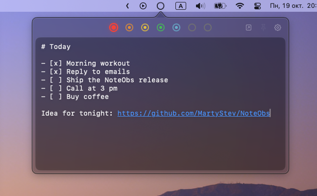
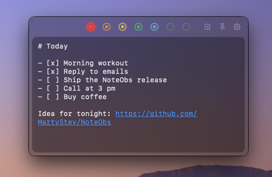

<p align="center">
  
</p>

<h1 align="center">NoteObs</h1>

<p align="center">
  Seven quick notes in the macOS menu bar.<br>
  Each one is a plain Markdown file in any folder you choose, including a cloud drive.
</p>

<p align="center">
  macOS 13+ · Swift 6.2 · no accounts, no servers · free · MIT license
</p>

<p align="center">
  
  &nbsp;
  
</p>

---

## The idea: any folder, synced by the cloud you already use

NoteObs has no server, no cloud and no account of its own. Your notes are the files `slot1.md … slot7.md` in the folder you pick, and nothing else.

- **Want sync between Macs?** Pick a folder inside a cloud drive that is already installed: iCloud Drive, OneDrive, Dropbox, Google Drive, Yandex Disk and so on. The drive's own client does the syncing, and there is nothing to sign in to in NoteObs.
- **Don't need sync?** Any local folder works.
- **Switching clouds?** Just pick another folder.
- The notes stay your files: open them in any editor, in Finder, in Obsidian or anything else. `obsidian://` links in the text are clickable, but Obsidian itself is not required.

## Features

- Seven notes, each with its own color. The menu bar icon opens a panel, which can also be detached into a window and pinned above other windows.
- Markdown text with clickable links (`https://`, `mailto:`, `obsidian://`) and checkboxes (`- [ ]` / `- [x]`).
- Font family and size, panel color and opacity, blur style, window size, launch at login.
- Right-click the icon for the list of notes, "Open folder in Finder", "Settings…" and "Quit NoteObs".

The interface language is Russian.

### Keyboard shortcuts

| Shortcut | Action |
|---|---|
| `⌘1` … `⌘7` | Jump to note 1–7 |
| `⌘⌥←` / `⌘⌥→` | Previous / next note |
| `⌘⇧C` | Toggle the checkbox on the current line (works on any keyboard layout) |
| `⌘←` / `⌘→` | Start / end of line, as in any editor |

The note shortcuts only act inside the NoteObs panel and window, not in Settings or dialogs.

## How notes are stored, and why they don't get lost

A cloud folder behaves differently from a local disk: access may wait for a macOS permission prompt, a file may not be downloaded yet, the provider may stall on a write, and a newer version may arrive from another Mac. NoteObs is built for exactly that:

- **Every change is backed up first.** Until the folder confirms a write, a copy of the text lives in `~/Library/Application Support/NoteObs/recovery`, outside the cloud folder, so a sync conflict or rollback can't erase the only copy. If the app quits before the folder took the text, NoteObs offers to restore it on the next launch.
- **Nothing is written until the folder has been read.** Text typed before the notes finished loading never overwrites them; it is offered back for restoring instead.
- **Edits from elsewhere are not overwritten.** If a note changed on another Mac and was left untouched here, the version in the folder wins.
- **An unreadable file never turns into an empty note.** If a file exists but can't be read (not UTF-8, not downloaded yet), writing to the folder stops, and NoteObs offers to open the folder in Finder and check again.
- **A slow or stalled folder doesn't freeze the app.** A read waits up to 5 seconds; if macOS is still asking for access, NoteObs says so and reconnects the folder on its own once it answers. A write that is taking too long is flagged as "not saving".
- **Failed writes are retried** with a growing delay, and each note has its own queue, so working in one note never cancels another's write.

### Limitations

- If the same note is edited on two Macs at the same time, the cloud client may create a conflict copy. That is for the cloud to resolve, not the app.
- The first time you pick a folder in a cloud drive, macOS asks for permission to access its files, and you need to approve it.

## Installation

After `make release-app`, the build is in `dist/` (not tracked in git): `NoteObs.app`, `NoteObs.dmg` and a zip archive. Drag `NoteObs.app` into Applications.

The build is ad-hoc signed (no Developer ID), so on another Mac macOS will warn about an unidentified developer on first launch: right-click the app and choose "Open".

## Building from source

Requires macOS 13+ and Swift 6.2 (Command Line Tools are enough; Xcode is optional).

```bash
make verify        # build and run the verification scenarios against real folders
make release-app   # release build, checks, NoteObs.app + dmg + zip in dist/
make icon          # redraw the icon, Assets/AppIcon.icns
```

`make verify` is the regression gate: the scenarios in `NoteObs/Verification.swift` run against temporary folders and never touch your notes or settings. They live inside the app itself (`NoteObs --verify`) because a Command Line Tools installation has no XCTest, so `swift test` would build fine and run zero tests.

## Project layout

| File | Responsibility |
|---|---|
| `NotesViewModel.swift` | Notes, per-note delayed writes, retries, reconciliation with the folder |
| `NotesFileStore.swift` | Reading and writing `slotN.md`, the per-folder write queue, protection for unreadable files |
| `RecoveryStore.swift` | Backups of unconfirmed text, and carrying them over from earlier builds |
| `NotesExternalChangeMonitor.swift` | Watching the files for outside changes |
| `NotesFolderAccess.swift` | Folder bookmarks and access, one identity for a folder reached by different paths |
| `AppDelegate.swift` | Menu bar icon, panel and window, dialogs about the folder's state |
| `AppSettings.swift`, `SettingsMigration.swift` | Settings, and carrying them over from earlier bundle identifiers |
| `Views.swift`, `MarkdownStyling.swift`, `Checklist.swift` | UI, link styling, checkboxes |
| `NoteShortcuts.swift` | Keyboard shortcuts |
| `Verification.swift` | The verification scenarios (`make verify`) |
| `Tests/NoteObsTests` | A thin wrapper that shows the same scenarios in Xcode's test navigator |
| `Tools/make-icon.swift` | The icon: the Big Dipper, one star per note, each in its note's color |

Repository structure:

```
NoteObs/            app sources (Swift, Info.plist)
Tests/              scenario wrapper for Xcode
Tools/              icon drawing script
Assets/             the finished AppIcon.icns
docs/               images for this README (icon, screenshots)
Package.swift       SwiftPM build (swift build / make)
NoteObs.xcodeproj   Xcode project (same sources)
Makefile            verify, release-app, icon
CHANGELOG.md        what changed in each version
LICENSE             MIT license
```

## License

[MIT](LICENSE) © 2026 MartyStev. Free to use, modify and distribute, as long as the copyright notice is kept.
